# CrackVision — Détection et métrologie de fissures dans le béton

> Trois modèles complémentaires pour l'inspection d'ouvrages d'art : un détecteur supervisé
> **YOLOX**, un **autoencodeur** entraîné uniquement sur du béton sain, et un modèle **hybride**
> qui combine les deux. Le tout est industrialisé en microservices Docker (Airflow, MLflow, DVC,
> FastAPI, nginx, Prometheus, Grafana).


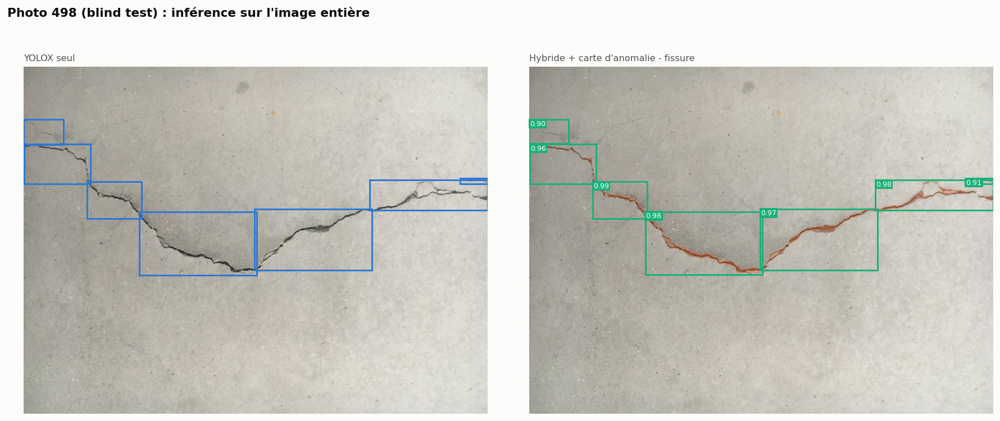

**En bref**, sur un blind test scellé de 69 photos (810 tuiles), jamais utilisé pour un réglage :

| | YOLOX (supervisé) | Autoencodeur (non supervisé) | Hybride |
|---|---|---|---|
| Détection des fissures, AP50 (boîtes) | **0,868** [0,840 ; 0,893] | — | **0,868** [0,841 ; 0,895] |
| Tuile fissurée ou saine, F1 | **0,977** [0,966 ; 0,987] | 0,901 [0,878 ; 0,923] | **0,978** [0,968 ; 0,987] |
| Tuile fissurée ou saine, AUROC | 0,997 | 0,957 | 0,994 |
| Localisation au pixel, AUROC | — | **0,977**, sans aucune étiquette | — |
| Latence par tuile 512 px (GPU A40) | 5,4 ms | 2,5 ms | 9,6 ms |

*Intervalles de confiance à 95 % par bootstrap groupé par photo (2 000 tirages). Seuils de
décision fixés sur la validation.*

---

## Sommaire

1. [Le problème métier](#le-problème-métier)
2. [Trois modèles, deux philosophies](#trois-modèles-deux-philosophies)
3. [Résultats sur le blind test](#résultats-sur-le-blind-test)
4. [Données : un jeu insensible au déséquilibre, une validation, un blind test](#données)
5. [Architecture MLOps](#architecture-mlops)
6. [Démarrage rapide](#démarrage-rapide)
7. [API](#api)
8. [Surveillance et dérive](#surveillance-et-dérive)
9. [Structure du projet](#structure-du-projet)
10. [Limites et extensions](#limites-et-extensions)
11. [Références](#références)

---

## Le problème métier

L'inspection visuelle des ouvrages d'art (ponts, tunnels, barrages, centrales nucléaires) est
réalisée manuellement par des inspecteurs qui photographient les surfaces et mesurent les
fissures au fissuromètre. Ce processus coûte **2 000 à 10 000 euros par jour**, reste subjectif
(deux inspecteurs ne reportent pas les mêmes défauts) et peut être dangereux (zones en hauteur,
environnements irradiés).

CrackVision prend une photo de surface béton et en tire trois choses. Il **détecte et localise
les fissures**, **signale les zones dont la structure s'écarte d'un béton sain**, sans qu'elles
aient été annotées, et produit un **rapport métrologique** : dimensions en pixels, en millimètres
si l'on fournit une calibration, longueur et ouverture estimées.

## Trois modèles, deux philosophies

L'article de référence [*Anomaly detection non supervisée vs détection de défauts
supervisée*](https://infoscribe.ai/anomaly-detection-non-supervisee-vs-detection-de-defauts-supervisee/)
résume l'enjeu. Le supervisé suppose que la liste des défauts est connue et illustrée par assez
d'exemples ; il nomme et gradue, mais ne voit pas un défaut absent de l'entraînement. Le non
supervisé suppose seulement que la normalité est représentable ; il détecte l'inattendu, mais
produit un score sans nom ni gravité, dont le seuil doit être calibré sur un échantillon de statut
connu. L'article recommande par défaut une architecture hybride : **le supervisé couvre le volume,
le non supervisé couvre le risque.**

| | YOLOX-s (supervisé) | Autoencodeur (non supervisé) | Hybride |
|---|---|---|---|
| Apprend sur | tuiles annotées (boîtes) | tuiles **saines** uniquement | sorties des deux, sur la validation |
| Répond à | « où sont les fissures connues ? » | « qu'est-ce qui s'écarte du béton sain ? » | « faut-il signaler cette surface, et où ? » |
| Sortie | boîtes + confiance | carte d'anomalie + score | probabilité de défaut, boîtes re-notées, anomalies non classées |
| Force | localise et nomme | sans annotation, localise au pixel les structures inhabituelles | combine précision et filet de sécurité |
| Faiblesse | aveugle à ce qu'il n'a pas vu | seuil à calibrer, insensible aux défauts lisses (taches) | dépend de la qualité des deux autres |

**YOLOX** ([Megvii, Apache 2.0](https://github.com/Megvii-BaseDetection/YOLOX)) est un détecteur
sans ancres à têtes découplées, avec assignation SimOTA. La variante s (9 M de paramètres) est
affinée depuis les poids COCO, en 512 px.

**L'autoencodeur** est convolutif et débruiteur : 5 étages de sous-échantillonnage et un goulot
de 8 × 8 × 8 pour une entrée de 256 px, soit 7 M de paramètres. Il apprend à reconstruire le béton
sain, et une fissure, qu'il n'a jamais vue, est mal reconstruite. La carte d'anomalie combine
l'erreur L1 et la dissimilarité structurelle 1 − SSIM, qui réagit moins au grain du béton qu'aux
discontinuités. Le score d'une tuile est la moyenne du 1 % de pixels les plus anormaux. Le réseau
n'apprend que sur des tuiles saines ; la validation annotée sert à choisir son architecture, son
point de contrôle et son seuil.

**Le modèle hybride** fusionne les deux à deux niveaux, par régression logistique ajustée sur la
validation :
- **boîte** : chaque détection YOLOX est re-notée avec l'évidence de l'autoencodeur à l'intérieur
  de la boîte (une fausse alarme sur du béton sain est pénalisée) ;
- **tuile** : la probabilité de défaut combine le meilleur score YOLOX, le nombre de boîtes, le
  score d'anomalie et la surface anormale ;
- **filet de sécurité** : une zone très anormale (au-delà du quantile 99,9 % des pixels sains de
  validation) qui ne recouvre aucune boîte YOLOX est remontée comme *anomalie non classée*.

## Résultats sur le blind test

Le blind test compte 69 photos (810 tuiles, dont 404 fissurées). Il n'a servi à aucun réglage :
meilleure époque, seuils de décision et fusion hybride ont tous été choisis sur la validation (69
autres photos). Les intervalles de confiance à 95 % viennent d'un bootstrap **groupé par photo**,
car les tuiles d'une même photo ne sont pas indépendantes.

### Classification des tuiles (fissurée ou saine)

| Modèle | F1 | MCC | Exactitude équilibrée | AUROC | AP | Faux positifs / négatifs |
|---|---|---|---|---|---|---|
| YOLOX | 0,977 [0,966 ; 0,987] | 0,953 | 0,977 | 0,997 | 0,997 | 10 / 9 |
| Autoencodeur | 0,901 [0,878 ; 0,923] | 0,800 | 0,900 | 0,957 | 0,967 | 44 / 37 |
| Hybride | 0,978 [0,968 ; 0,987] | 0,956 | 0,978 | 0,994 | 0,996 | 9 / 9 |

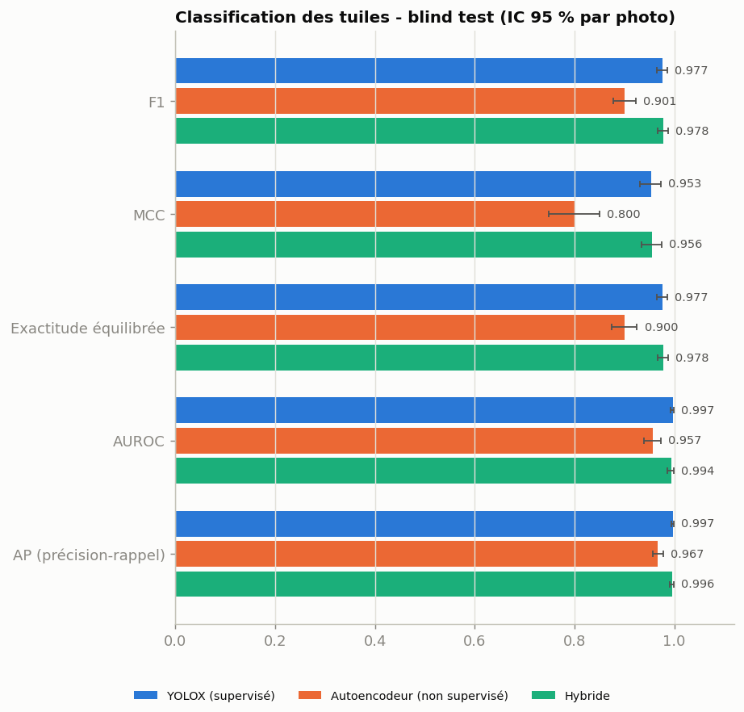

### Détection des fissures (boîtes)

| Modèle | AP50 | AP50:95 | AP75 | Précision / rappel au seuil |
|---|---|---|---|---|
| YOLOX | 0,868 [0,840 ; 0,893] | 0,652 | 0,711 | 0,854 / 0,804 |
| Hybride | 0,868 [0,841 ; 0,895] | 0,649 | 0,710 | 0,868 / 0,778 |

<p align="center">
  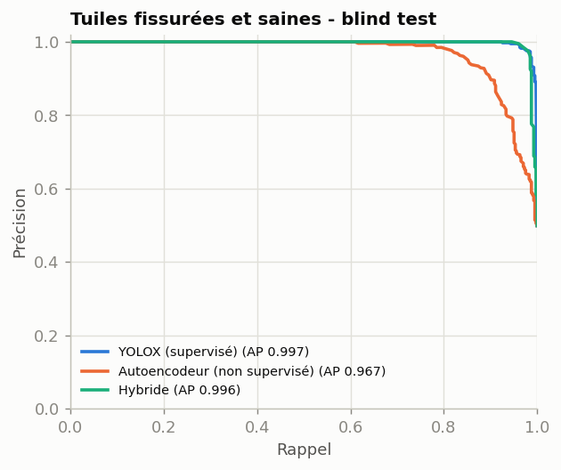
  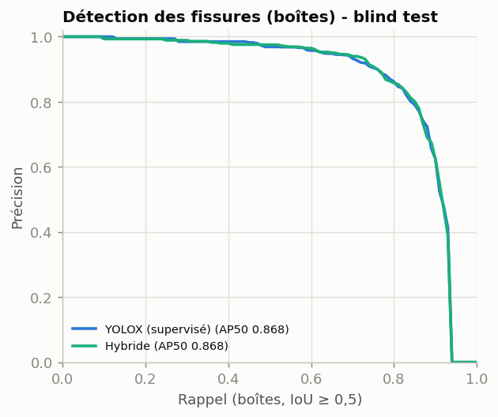
</p>

### Ce que montrent les exemples

Chaque ligne présente une tuile du blind test : la vérité terrain (masque et boîtes en
pointillés), puis la sortie de chaque modèle. La carte d'anomalie de l'autoencodeur (en orange)
suit la fissure au pixel près, sans avoir jamais vu une seule fissure annotée. Le modèle hybride
s'en sert pour re-noter les boîtes : sur la première tuile, la confiance passe de 0,66 (YOLOX) à
0,91. L'avant-dernière tuile, étiquetée saine, porte en fait une fissure capillaire absente du
masque d'origine : une partie des « fausses alarmes » vient d'oublis d'annotation.

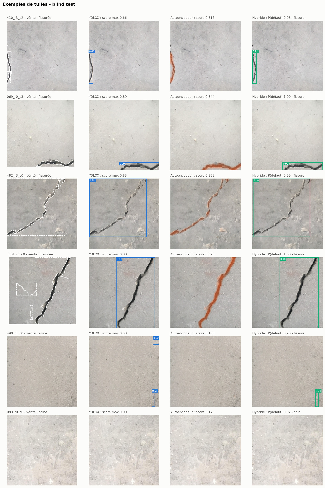

### Galerie : six photos entières du blind test

Les photos sont choisies par des critères fixés à l'avance, et non à la main, pour couvrir des
cas variés et montrer aussi les échecs. La commande `crackvision gallery` les régénère. À gauche
figure la vérité terrain (masque en blanc), à droite la prédiction du modèle hybride : boîtes de
fissure en vert, carte d'anomalie en orange, anomalies non classées en violet pointillé.

| Photo | Critère de choix | Fissures détectées | Tuiles fissurées manquées | Fausses alarmes |
|---|---|---|---|---|
| 490 | fissure la plus étendue (3,5 % des pixels) | 11 | 0 | 1 |
| 027 | fissure la plus fine (0,55 % des pixels) | 7 | 0 | 0 |
| 445 | le plus de fissures distinctes (6) | 7 | 0 | 0 |
| 498 | cas médian | 7 | 0 | 0 |
| 555 | le plus d'erreurs du modèle hybride | 10 | 2 | 0 |
| 083 | tirée au hasard | 5 | 0 | 0 |

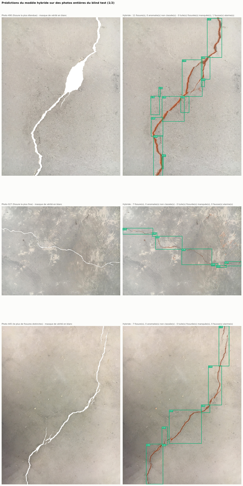

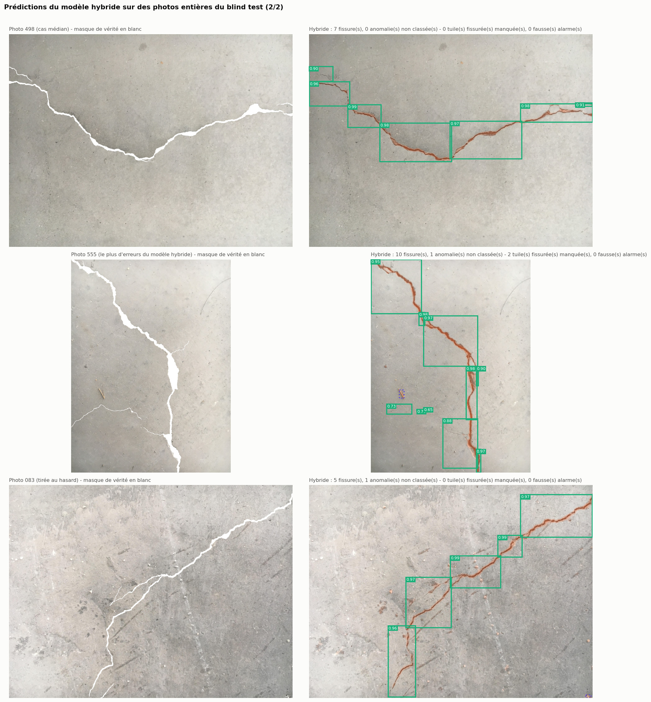

Ce qu'on y voit :

- **La fissure la plus fine (027)** est suivie sur toute la largeur de la photo, alors qu'elle ne
  fait que quelques pixels de large après réduction.
- **Les boîtes découpent une fissure longue en segments**, à l'image des boîtes de vérité, qui
  sont tirées des composantes de fissure dans chaque tuile. Pour mesurer une fissure entière, il
  faut additionner ses segments, ou passer par une segmentation.
- **La pire photo (555) ne compte que 2 tuiles en erreur sur 12** : la branche très fine en bas à
  gauche n'est détectée qu'en partie (confiances de 0,65 à 0,73). Sur la même photo, le filet de
  sécurité signale en violet une brindille posée sur le mur : un objet étranger, qui n'est pas une
  fissure. C'est exactement ce qu'on attend de lui.

### Lecture critique

- **YOLOX est déjà au plafond pour dire si une tuile est fissurée** (AUROC 0,997). Sur ce critère,
  l'hybride fait jeu égal, sans le dépasser de façon significative : les intervalles se
  recouvrent largement.
- **L'autoencodeur atteint 0,957 d'AUROC sans aucune annotation.** Il localise surtout les
  fissures au pixel (AUROC 0,977, AP 0,79), ce qu'une boîte englobante ne fait pas. C'est cette
  carte qui alimente la métrologie d'ouverture du modèle hybride.
- **La fusion rend le modèle plus prudent sur les boîtes** : sa précision au seuil passe de 0,854 à
  0,868, au prix d'un peu de rappel (de 0,804 à 0,778).
- **Le filet de sécurité a un coût** : 26 tuiles saines sur 406 (6,4 %) sont remontées comme
  « anomalie non classée » à vérifier, et 5 tuiles fissurées que la décision principale
  n'aurait pas retenues le sont aussi.

### Test de résistance : des défauts que personne n'a annotés

L'article de référence attribue au non supervisé la couverture du risque, c'est-à-dire des
défauts absents de l'entraînement. Le jeu ne contenant que des fissures, j'ai incrusté quatre
défauts **synthétiques**, jamais annotés, dans 100 tuiles saines du blind test : tache
d'humidité, efflorescence, coulure de rouille et éclat de béton.

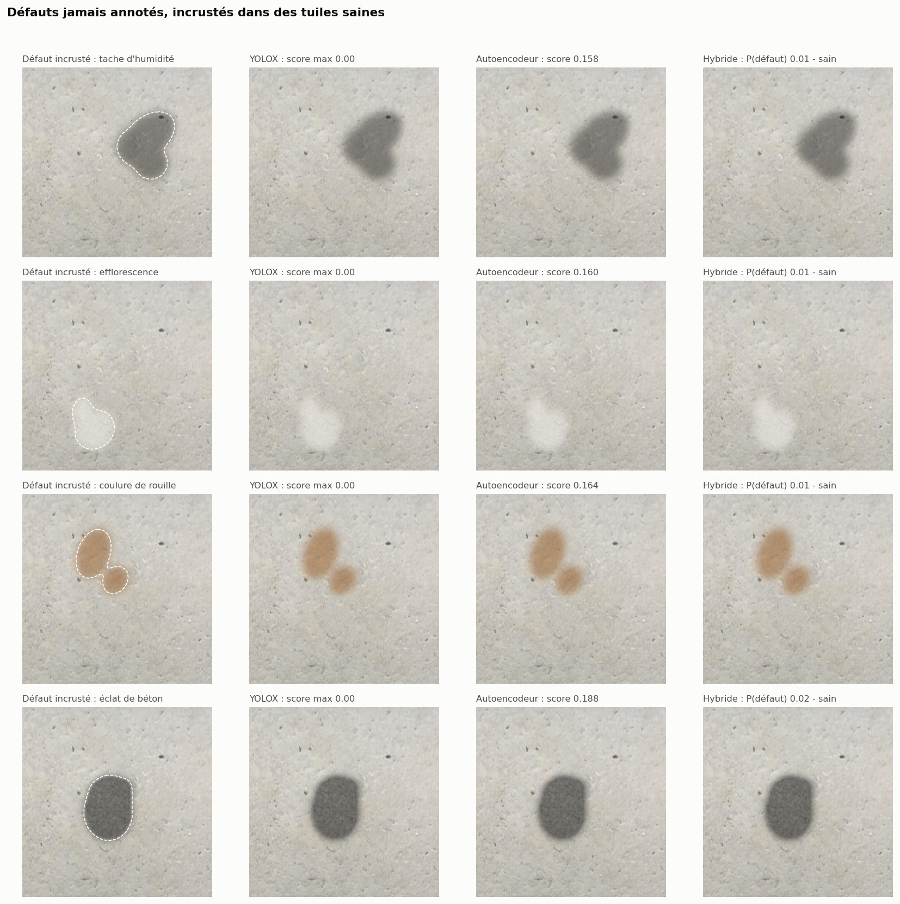

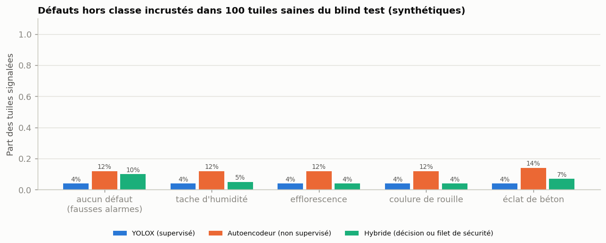

**Résultat : aucun des trois modèles ne les signale** au-delà de son taux de fausses alarmes sur
les tuiles intactes. Pour l'hybride, la barre « aucun défaut » compte toute zone signalée sur la
tuile, et les autres barres seulement celles qui recouvrent le défaut incrusté. Ce résultat
négatif est instructif :

- un autoencodeur reconstruit sans peine les variations lentes de couleur ou de luminosité (taches,
  dépôts, coulures), et ne réagit qu'aux structures fines qu'il ne sait pas reproduire, comme les
  fissures ;
- choisir son point de contrôle sur l'AUROC des fissures l'a encore spécialisé sur ce motif.

Pour couvrir ce type de défaut « contextuel », la limite que l'article prête justement au non
supervisé, il faudrait une méthode à base de descripteurs pré-entraînés (PatchCore, PaDiM), ou
bien un corpus de défauts réels à annoter. C'est la trajectoire que propose l'article.

### Entraînement

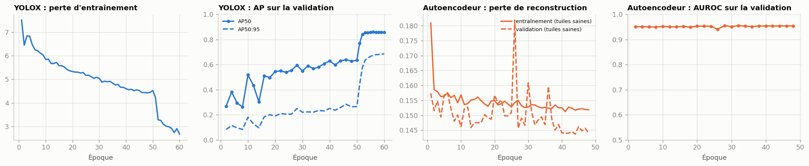

YOLOX-s a été affiné pendant 60 époques en 45 minutes sur un GPU A40, avec la précision mixte.
L'AP50 de validation plafonne vers 0,64 tant que l'augmentation mosaïque est active. Elle bondit à
0,86 lors des 10 dernières époques sans mosaïque : la mosaïque rétrécit les fissures, ce qui
l'éloigne de la distribution de test. L'autoencodeur est retenu à l'époque où son AUROC de
validation est la meilleure (époque 28), et non à celle de sa plus faible perte de reconstruction.
Bien reconstruire le béton finit en effet par apprendre à reconstruire les fissures (voir le
[journal des décisions](DECISIONS.md), M4 bis).

## Données

### Source

[**Concrete Crack Segmentation Dataset**](https://data.mendeley.com/datasets/jwsn7tfbrp/1)
(Özgenel, 2019) : 458 photos 4032 × 3024 de murs en béton du campus de la METU, chacune avec son
masque de fissure au pixel, sous licence CC BY 4.0. L'archive est téléchargée et son empreinte
SHA-256 vérifiée par l'étape `ingest`.

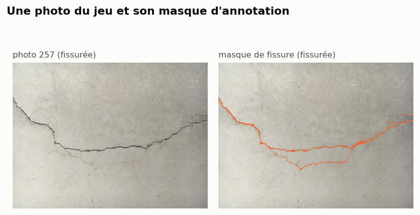

### Préparation

Les photos sont réduites de moitié (2016 × 1512), puis découpées en **12 tuiles de 512 px**. Les
boîtes de vérité sont les composantes connexes du masque, après une fermeture morphologique qui
recolle les fragments d'une même fissure. Chaque tuile reçoit une étiquette :

- **fissurée** : au moins une composante assez grande pour former une boîte ;
- **saine** : aucun pixel de fissure dans la tuile ni dans une marge de 16 px autour d'elle ;
- **ambiguë** : un simple fragment ou une fissure qui frôle le bord. Ces tuiles sont exclues pour
  ne pas mélanger les classes.

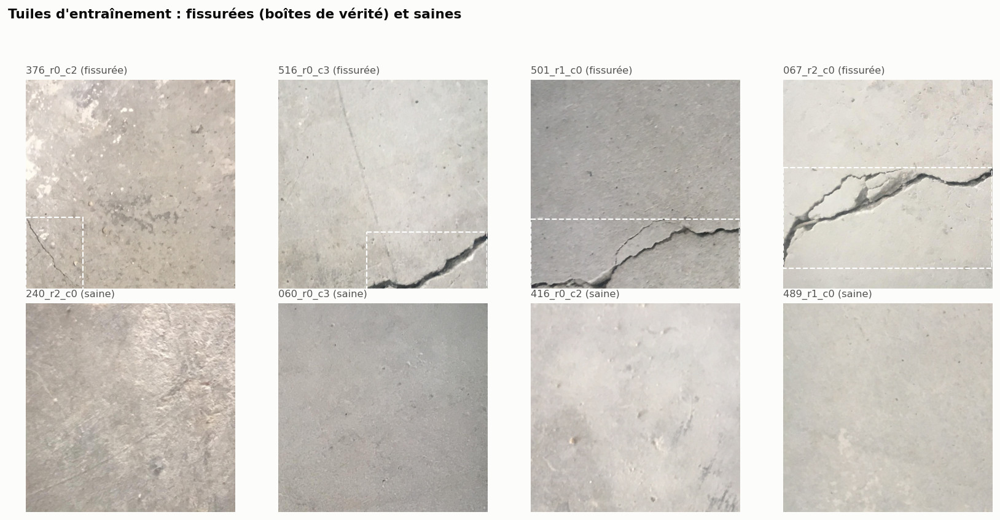

### Un jeu d'entraînement, une validation, un blind test

Le **découpage se fait par photo**, jamais par tuile : les tuiles d'une même photo se ressemblent,
et les répartir entre deux jeux ferait fuir de l'information. Il est **stratifié** sur le taux de
fissure (quantiles) et le nombre de fissures de chaque photo. Il est déterministe (graine 42).

| Jeu | Photos | Tuiles | Fissurées | Saines | Ambiguës (exclues) | Boîtes |
|---|---|---|---|---|---|---|
| Entraînement | 320 | 3 840 | 1 893 | 1 827 | 120 | 2 592 |
| Validation | 69 | 828 | 414 | 392 | 22 | 571 |
| Blind test | 69 | 828 | 404 | 406 | 18 | 591 |

À l'échelle de la tuile, les classes sont presque équilibrées (49 % de tuiles fissurées), car les
fissures sont longues et traversent plusieurs tuiles. Le déséquilibre porte surtout sur les
**sous-types** de fissures : les petites ne représentent que 16 % des tuiles fissurées.

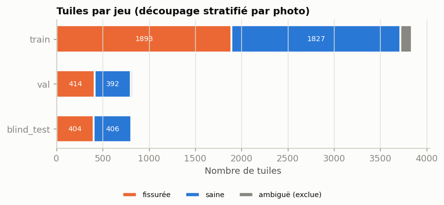

**Entraînement insensible au déséquilibre.** Le jeu d'entraînement de YOLOX est rééquilibré sur
deux niveaux :
1. **dans les tuiles fissurées**, par *repeat factor sampling* (Gupta et al., LVIS 2019) : une
   tuile dont la taille, l'orientation ou le nombre de fissures est rare (fréquence f inférieure au
   seuil t = 0,25) est répétée √(t / f) fois en moyenne ;
2. **entre classes**, en tirant autant de tuiles saines que nécessaire pour obtenir 50 % de tuiles
   fissurées.

Les répétitions sont écrites dans l'annotation COCO (nouvel identifiant, même fichier), sans
copier d'image. L'autoencodeur, lui, n'apprend que sur les tuiles saines de l'entraînement.

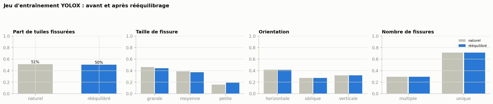

La **validation** et le **blind test** gardent la distribution naturelle : on mesure les
performances dans les conditions réelles d'emploi. Tous les réglages (meilleure époque, seuils,
fusion hybride) se font sur la validation. Le **blind test est scellé** : chaque fichier a son
empreinte SHA-256 (`MANIFEST.sha256`), revérifiée avant l'évaluation. Seule l'étape
`evaluate@blind_test` le lit, ce que vérifie un test automatique.

## Architecture MLOps

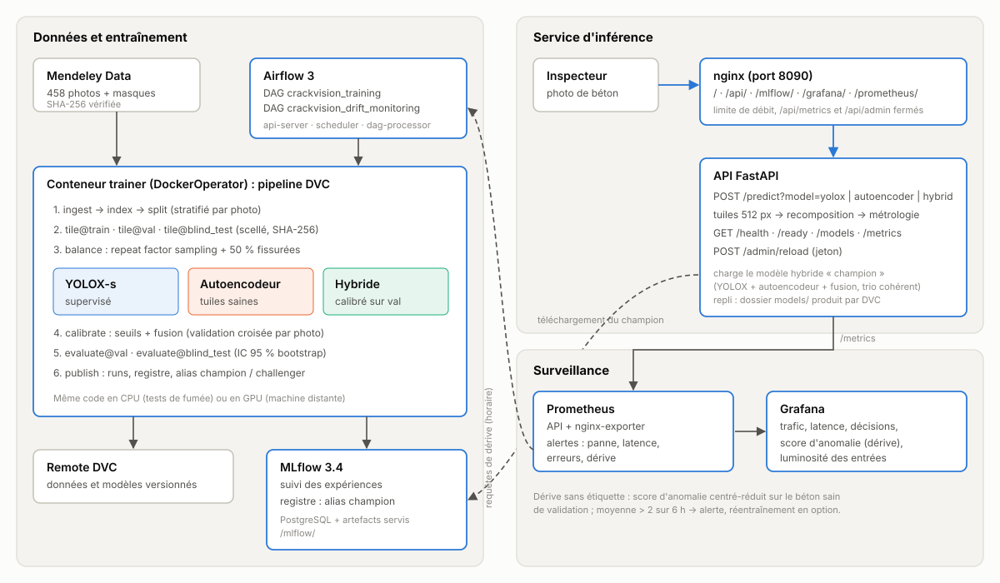

| Service | Rôle | Image |
|---|---|---|
| `nginx` | point d'entrée unique (port 8090), limite de débit, routes internes fermées | nginx 1.27 |
| `api` | inférence FastAPI : YOLOX, autoencodeur, hybride, métrologie, `/metrics` | `crackvision-api` |
| `mlflow` | suivi des expériences, registre de modèles, alias `champion` | `crackvision-mlflow` (MLflow 3.4) |
| `postgres` | métadonnées Airflow et MLflow | PostgreSQL 16 |
| `airflow-*` | orchestration : api-server, scheduler, dag-processor (LocalExecutor) | Airflow 3.2.1 |
| `trainer` | étapes DVC, entraînement, évaluation, tests (lancé par DockerOperator) | `crackvision-trainer` |
| `prometheus` | collecte des métriques, règles d'alerte | Prometheus 3.5 |
| `grafana` | tableau de bord service et dérive, provisionné | Grafana 12.1 |
| `nginx-exporter` | métriques nginx | 1.4.2 |

### Pipeline DVC

```
ingest → index → split → tile@train · tile@val · tile@blind_test → balance → data_report
balance → train_yolox ──┐
balance → train_autoencoder ┴→ calibrate → evaluate@val → evaluate@blind_test
```

Chaque étape déclare ses dépendances (code, données, paramètres de `params.yaml`), et `dvc repro`
ne refait que ce qui a changé. Les données et les modèles sont versionnés dans le remote DVC ; git
ne suit que `dvc.lock` et les métriques.

### Orchestration Airflow

Le DAG `crackvision_training` exécute chaque étape DVC dans un conteneur `trainer` (DockerOperator),
puis publie les modèles dans MLflow et demande à l'API de recharger le champion. Son paramètre
`mode=smoke` rejoue toute la chaîne en quelques minutes sur des données synthétiques. Le DAG
`crackvision_drift_monitoring` interroge Prometheus chaque heure et peut déclencher un
réentraînement.

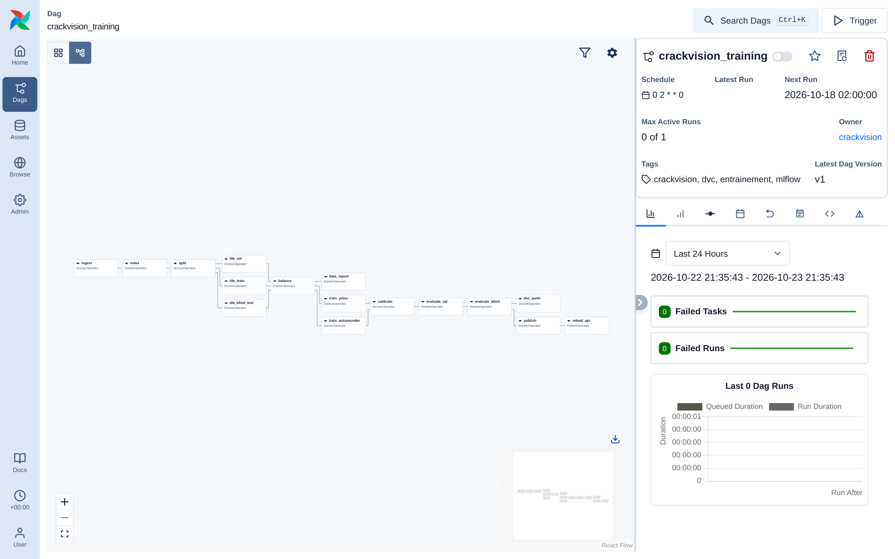

### Registre et promotion

`crackvision publish` crée un run parent (paramètres, données, rapports) et un run par modèle
(historique, métriques de validation et de blind test, modèle au format pyfunc). Il enregistre
ensuite les trois modèles dans le registre. L'alias **`champion`** n'est accordé que si le blind
test passe les seuils de `promotion.gates` et fait au moins aussi bien que le champion en place,
mesuré sur le même blind test. Sinon, la version reçoit l'alias `challenger`. L'API charge le
modèle hybride champion, qui embarque YOLOX et l'autoencodeur : le trio servi est toujours
cohérent.

<p align="center">
  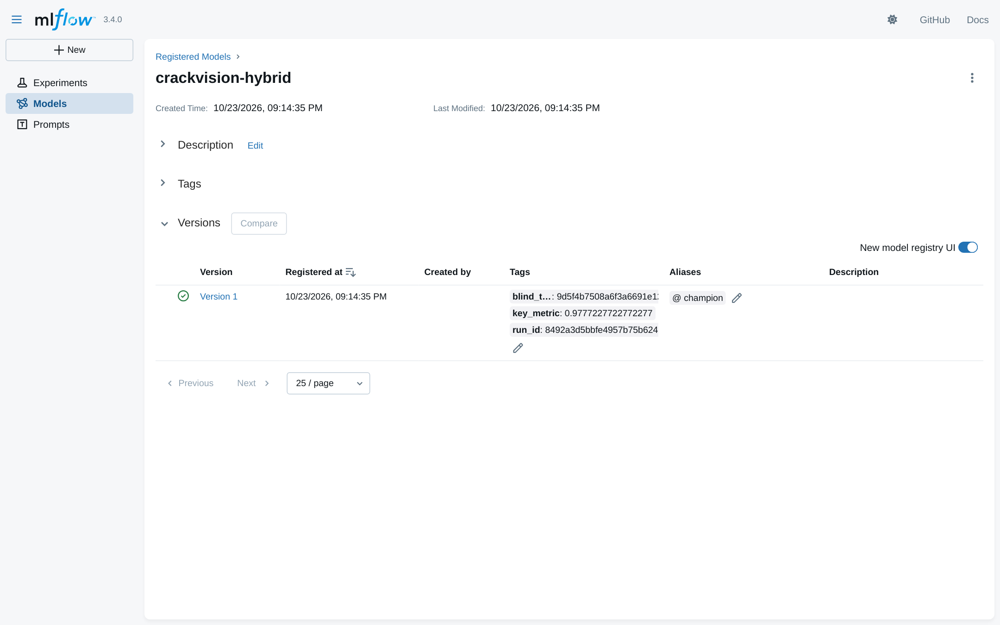
  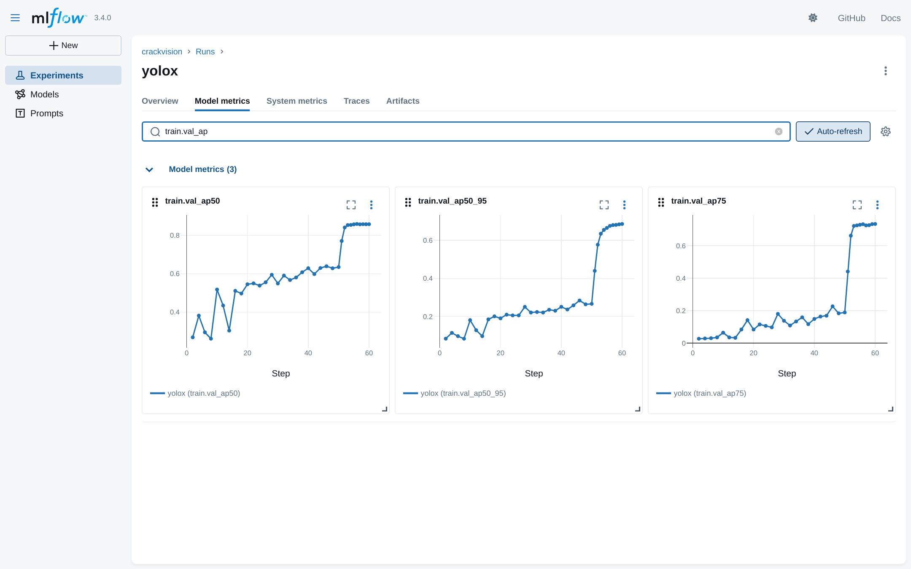
</p>

## Démarrage rapide

Prérequis : Docker avec Compose v2 et environ 4 Go de mémoire pour la pile complète. Un GPU
NVIDIA est fortement conseillé pour l'entraînement.

### 1. Construire et lancer la pile

```bash
git clone <url-du-depot> CrackVision && cd CrackVision
cp .env.example .env                                     # remplacer chaque « a-changer »
docker compose --profile tools --profile airflow build   # api, trainer, mlflow, airflow
docker compose up -d                                     # service, suivi, surveillance
docker compose --profile airflow up -d                   # orchestration (facultatif)
```

Ouvrez ensuite http://localhost:8090 pour l'interface de démonstration, `/api/docs` pour l'API,
`/mlflow/`, `/grafana/` et `/prometheus/`. Airflow est sur http://localhost:8091.

### 2. Vérifier l'installation, sans GPU ni données

```bash
docker compose run --rm trainer python -m pytest -q
```

Les 51 tests rejouent toute la chaîne sur des photos synthétiques, en quelques minutes sur CPU :
préparation des données, entraînement des trois modèles, évaluation et réponses de l'API.

### 3. Produire les données et les modèles

Le dépôt git ne contient ni les photos ni les modèles : DVC les reconstruit. L'étape `ingest`
télécharge le jeu de données public et vérifie son empreinte SHA-256. L'entraînement de YOLOX
part des poids COCO officiels, vérifiés de la même façon.

```bash
docker compose run --rm trainer dvc repro                          # toute la chaîne
docker compose run --rm trainer python -m crackvision.cli publish  # MLflow et alias champion
```

L'image `trainer` embarque PyTorch pour CPU, et sur CPU l'entraînement complet prend des
dizaines d'heures. Sur un GPU (environ 1 h sur un A40), deux voies sont possibles :

- **avec Docker et Airflow** : `TRAINER_TORCH=cuda` et `TRAINER_GPU=true` dans `.env`, puis
  reconstruire `trainer` et lancer le DAG `crackvision_training` ;
- **sans Docker**, sur une machine GPU louée par exemple : `bash scripts/gpu_setup.sh` puis
  `bash scripts/run_pipeline_gpu.sh`, et `crackvision publish` près du serveur MLflow.

Tant qu'aucun modèle n'existe, `/api/ready` répond 503. Le remote DVC est un dossier local
(`.dvc-storage/`, ignoré par git) : `dvc push` y archive chaque version des données et des
modèles, et `dvc pull` la restaure. Pour une équipe, on le remplace par un stockage partagé (S3,
MinIO, SSH) avec `dvc remote modify`.

Le [guide d'exploitation](docs/exploitation.md) détaille l'entraînement sur GPU, la promotion et
le retour arrière, et la conduite à tenir pour chaque alerte. Les choix techniques sont justifiés
dans le [journal des décisions](DECISIONS.md).

## API

| Méthode | Route | Rôle |
|---|---|---|
| `POST` | `/api/predict?model=hybrid\|yolox\|autoencoder` | analyse d'une photo (multipart `file`) |
| `GET` | `/api/models` | version servie, seuils de décision, prétraitement |
| `GET` | `/api/health` · `/api/ready` | vivacité · modèles chargés |
| `POST` | `/admin/reload` | recharge le champion (réseau interne, jeton `X-Admin-Token`) |
| `GET` | `/metrics` | métriques Prometheus (réseau interne) |

Options de `/predict` : `pixel_per_mm` (calibration, ajoute les mesures en mm) et
`return_heatmap=true` (carte d'anomalie en PNG base64).

```bash
curl -F "file=@photo.jpg" "http://localhost:8090/api/predict?model=hybrid&pixel_per_mm=10"
```

Extrait d'une réponse réelle, pour une photo 4032 × 3024 du blind test :

```json
{
  "modele": "hybrid",
  "version": "1",
  "source": "mlflow:crackvision-hybrid@champion",
  "decision": "defaut",
  "niveau": "fissure",
  "score": 0.9913,
  "seuil": 0.346,
  "image": {"largeur": 4032, "hauteur": 3024, "tuiles": 12, "echelle": 0.5},
  "fissures": [
    {
      "id": 1,
      "confiance": 0.9615,
      "boite": [2006.0, 1442.4, 3030.0, 1980.2],
      "mesures": {
        "largeur_mm": 102.4, "hauteur_mm": 53.78, "diagonale_mm": 115.66,
        "longueur_estimee_mm": 133.7, "ouverture_moyenne_mm": 1.744, "ouverture_max_mm": 4.202
      }
    }
  ],
  "anomalies_non_classees": [],
  "latence_ms": 1445.0
}
```

Une image entière suit exactement le prétraitement de l'entraînement : réduction de moitié,
tuiles de 512 px, puis recomposition dans le repère de l'image d'origine (fusion des boîtes
coupées par un bord de tuile). Le même code sert à l'entraînement et au service : pas d'écart de
prétraitement entre les deux.

L'interface de démonstration servie par nginx envoie une photo à l'API et affiche les boîtes, la
carte d'anomalie et le tableau métrologique. Sur une photo de 12 Mpx, il faut environ 1,4 s en
CPU (4 fils).

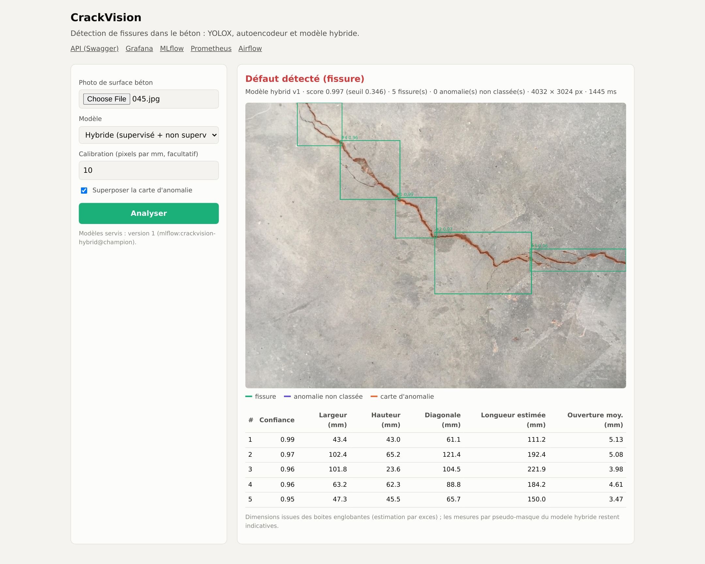

### Métrologie

Pour chaque fissure, l'API renvoie la largeur, la hauteur, la surface et la diagonale de la boîte
englobante, en pixels de l'image d'origine, et en millimètres si `pixel_per_mm` est fourni. Le
modèle hybride ajoute une **longueur estimée** (squelette du pseudo-masque d'anomalie dans la
boîte) et une **ouverture moyenne et maximale** (transformée de distance le long du squelette).

Ces mesures restent des estimations. La boîte surestime la surface d'une fissure oblique, d'un
facteur jusqu'à √2 sur la diagonale. La carte d'anomalie est lissée et élargit donc l'ouverture.
Sans calibration, les dimensions restent en pixels. Une prise de vue non perpendiculaire déforme
les mesures.

## Surveillance et dérive

L'API expose des métriques de trafic (débit, erreurs, latence par modèle) et des **indicateurs de
dérive qui ne demandent aucune étiquette** :
- le **score d'anomalie de l'autoencodeur, centré-réduit** sur le béton sain de validation. Il
  reste proche de 0 tant que les images ressemblent aux données d'entraînement. Une moyenne
  durablement supérieure à 2 signale une dérive (nouveau type de surface, salissure, caméra) ;
- la **luminosité** moyenne des images reçues ;
- la **part d'images signalées** par le modèle hybride, et le nombre d'anomalies non classées.

Prometheus porte six règles d'alerte : API indisponible, modèles non chargés, latence, erreurs 5xx,
dérive du score d'anomalie, images sombres. Grafana affiche un tableau de bord provisionné.

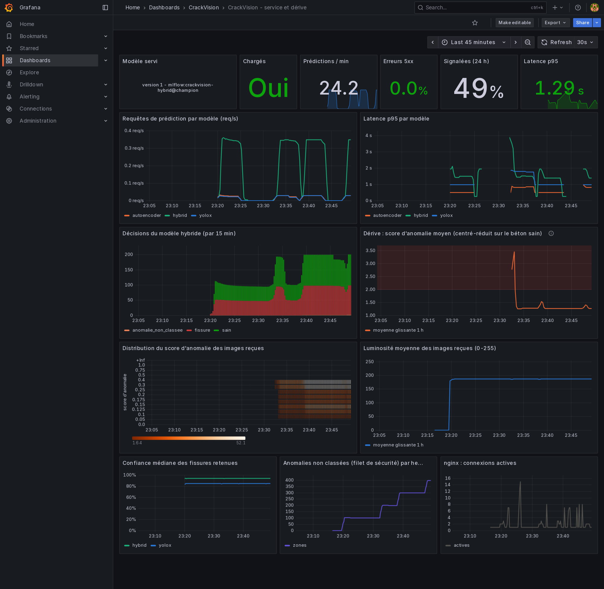

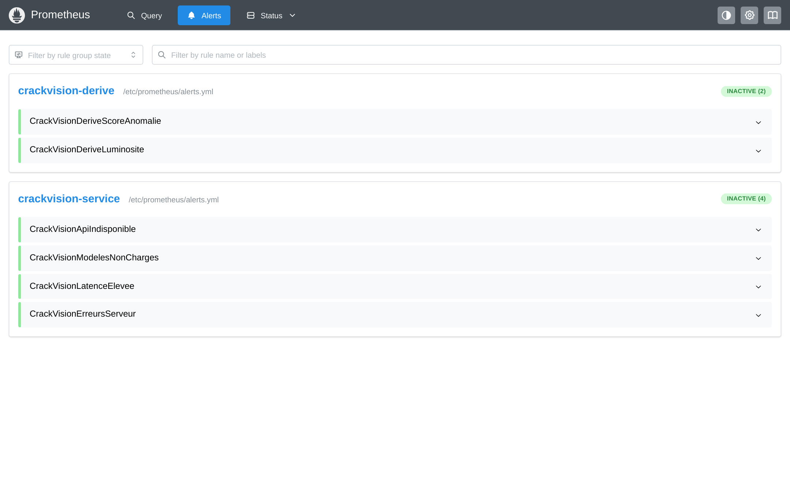

## Structure du projet

```
CrackVision/
├── README.md · DECISIONS.md · params.yaml · dvc.yaml · dvc.lock · pyproject.toml
├── docker-compose.yml · .env.example
├── configs/smoke.yaml              # profil de fumée (CPU, données synthétiques)
├── src/crackvision/
│   ├── data/                       # sources, tuiles, découpage, rééquilibrage, COCO
│   ├── models/                     # YOLOX, autoencodeur, fusion hybride
│   ├── training/                   # entraînements, calibration de la fusion
│   ├── evaluation/                 # métriques, évaluation, figures
│   ├── serving/                    # API FastAPI, chargement des modèles, métriques Prometheus
│   ├── inference.py                # chaîne commune évaluation / service
│   ├── metrology.py · registry.py · tracking.py · cli.py
├── airflow/dags/                   # crackvision_training, crackvision_drift_monitoring
├── docker/                         # ml/ (trainer + api), mlflow/, airflow/, nginx/, postgres/, certs/
├── monitoring/                     # prometheus/ (collecte, alertes), grafana/ (provisionnement)
├── requirements/                   # dépendances figées par image
├── scripts/                        # environnement et pipeline sur GPU distant sans Docker
├── tests/                          # données, modèles, métriques, règles DVC, API, fumée
├── docs/                           # guide d'exploitation, images du README
├── data/ · models/ · reports/      # produits par DVC (non suivis par git)
```

## Limites et extensions

**Limites**
1. **Un seul type de défaut annoté.** Le jeu ne contient que des fissures. Le test de résistance
   montre que l'autoencodeur, tel qu'il est conçu, ne remonte pas les défauts lisses et étendus
   (taches, dépôts, coulures) : la promesse « le non supervisé couvre le risque » ne vaut ici que
   pour les défauts de structure fine.
2. **Annotations incomplètes.** Les masques d'origine omettent certaines fissures capillaires.
   Des tuiles étiquetées saines en portent, ce qui rend les métriques légèrement pessimistes.
3. **Un seul domaine.** Les 458 photos viennent des murs d'un même campus. Un autre béton, un
   autre éclairage ou un autre capteur demanderont un recalibrage, ce que la surveillance de dérive
   aide justement à détecter.
4. **Boîte contre fissure.** La boîte englobante est une enveloppe : elle surestime la fissure,
   surtout si celle-ci est oblique. AP50:95 est donc peu pertinent ici ; l'AP50 est le critère de
   sélection.
5. **Mesures absolues.** Sans facteur de calibration (objet de référence, distance connue), les
   dimensions restent en pixels. La perspective les déforme si la caméra n'est pas perpendiculaire.

**Extensions**
- Segmentation d'instance (YOLOX-seg, Mask R-CNN) pour mesurer l'ouverture au pixel près.
- Méthodes d'anomalie à base de descripteurs pré-entraînés (PatchCore, PaDiM), plus sensibles
  que l'autoencodeur.
- Export ONNX ou TensorRT pour l'inférence embarquée (drone, robot d'inspection).
- Rapport PDF automatique par ouvrage, avec la localisation et l'historique de chaque défaut.
- Boucle d'annotation active : les anomalies non classées alimentent une nouvelle classe
  supervisée, la trajectoire progressive que recommande l'article de référence.

## Références

- *Anomaly detection non supervisée vs détection de défauts supervisée*, infoscribe.ai —
  https://infoscribe.ai/anomaly-detection-non-supervisee-vs-detection-de-defauts-supervisee/
- Ge, Liu, Wang, Li, Sun (2021). *YOLOX: Exceeding YOLO Series in 2021*. arXiv:2107.08430.
- Özgenel, Ç. F. (2019). *Concrete Crack Segmentation Dataset*. Mendeley Data, V1.
  doi:10.17632/jwsn7tfbrp.1 (CC BY 4.0).
- Bergmann, Löwe, Fauser, Sattlegger, Steger (2019). *Improving Unsupervised Defect Segmentation
  by Applying Structural Similarity to Autoencoders*. VISAPP.
- Gupta, Dollár, Girshick (2019). *LVIS: A Dataset for Large Vocabulary Instance Segmentation*.
  CVPR (repeat factor sampling).

## Auteur

Projet réalisé dans le cadre d'un portfolio Data Science / IA industrielle.
Profil : docteur-ingénieur, expertise physique, métrologie et contrôle non destructif, en
reconversion vers l'IA.

---

*Ce projet montre comment industrialiser une chaîne de vision par ordinateur de bout en bout : de
la donnée versionnée au modèle surveillé en production. Il apporte en plus une réflexion
métrologique d'ingénieur sur ce que mesure vraiment chaque modèle.*
